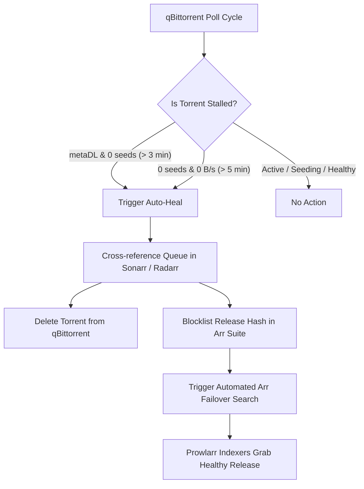

# Watcherr

Automated stalled torrent auto-healing and indexer failover watchdog daemon for Sonarr, Radarr, and qBittorrent.

---

## Overview

When automated media stacks (Sonarr, Radarr, Prowlarr) grab torrents from public or semi-private indexers, release metadata on indexers is frequently stale. A torrent reported as having multiple seeders may actually have zero connected peers or may hang indefinitely in metadata acquisition (`metaDL`).

By default, Sonarr and Radarr do not automatically discard or re-index stalled downloads with zero seeds. Instead, downloads remain stuck in the queue forever, blocking downstream automated pipeline workflows and requiring manual intervention.

**Watcherr** runs as a lightweight, autonomous background daemon. It monitors qBittorrent and cross-references active downloads with Sonarr and Radarr queues. When a stalled torrent with zero seeders is detected, Watcherr automatically:
1. Deletes the dead torrent and its associated payload from qBittorrent.
2. Blocklists the release hash in Sonarr / Radarr so that specific broken release is never downloaded again.
3. Dispatches an automated search command (`EpisodeSearch`, `SeriesSearch`, or `MoviesSearch`) in Sonarr / Radarr to immediately acquire an alternative healthy release via Prowlarr / Jackett.

---

## Workflow Diagram



---

## Features

- **Zero External Dependencies**: Built entirely using Python standard libraries (`urllib.request`, `json`, `argparse`, `logging`). No `pip install` required for bare-metal runs.
- **Bi-Directional Arr Integration**: Automatically correlates qBittorrent info-hashes with Sonarr v3/v4 and Radarr v3/v5 queue records.
- **Failover Search Execution**: Triggers automated episode, season, or movie searches immediately after blocklisting to resume media acquisition without delay.
- **Zero-Touch Local Auto-Discovery**: Automatically parses local Sonarr/Radarr XML configuration files (`/var/lib/sonarr/config.xml`, `~/.config/Sonarr/config.xml`, etc.) when running on the same host.
- **qBittorrent WebUI Authentication**: Supports both open local WebUI bypasses and password-authenticated sessions.
- **Dry-Run Mode**: Inspect and log what would be pruned without mutating queues or download states.
- **Minimal Footprint**: Operates with less than 15 MB RAM usage and negligible CPU consumption.
- **Deploy Anywhere**: Runs natively via Systemd, standalone CLI, Docker, or Docker Compose.

---

## Requirements

- Python 3.10 or newer
- qBittorrent 4.x / 5.x with WebUI enabled
- Sonarr v3 or v4 (API v3 enabled)
- Radarr v3, v4, or v5 (API v3 enabled)

---

## Quick Start

### 1. Standalone CLI Run

```bash
# Clone the repository
git clone https://github.com/T1n777/watcherr.git
cd watcherr

# Run a single inspection pass in dry-run mode
python3 watcherr.py --once --dry-run

# Run continuously as a daemon
python3 watcherr.py \
  --qbit-url http://127.0.0.1:8080 \
  --sonarr-url http://127.0.0.1:8989 \
  --sonarr-api-key YOUR_SONARR_API_KEY \
  --radarr-url http://127.0.0.1:7878 \
  --radarr-api-key YOUR_RADARR_API_KEY
```

---

### 2. Systemd Service (Linux Bare-Metal)

1. Copy the script to `/usr/local/bin/watcherr`:
   ```bash
   sudo install -Dm755 watcherr.py /usr/local/bin/watcherr
   ```

2. Install and enable the systemd unit:
   ```bash
   sudo cp watcherr.service /etc/systemd/system/watcherr.service
   sudo systemctl daemon-reload
   sudo systemctl enable --now watcherr.service
   ```

3. View live daemon logs:
   ```bash
   journalctl -u watcherr.service -f
   ```

---

### 3. Docker Compose

```yaml
services:
  watcherr:
    image: ghcr.io/t1n777/watcherr:latest
    build: .
    container_name: watcherr
    restart: unless-stopped
    network_mode: host
    environment:
      - QBIT_URL=http://127.0.0.1:8080
      - SONARR_URL=http://127.0.0.1:8989
      - RADARR_URL=http://127.0.0.1:7878
      - SONARR_API_KEY=your_sonarr_api_key_here
      - RADARR_API_KEY=your_radarr_api_key_here
      - METADATA_STALL_SECONDS=180
      - ZERO_SEED_STALL_SECONDS=300
      - CHECK_INTERVAL_SECONDS=45
      - DRY_RUN=false
```

Start the container:
```bash
docker compose up -d
```

---

## Configuration Reference

All settings can be specified via command-line arguments or environment variables. Command-line flags take precedence over environment variables.

| Command-Line Flag | Environment Variable | Default | Description |
|---|---|---|---|
| `--qbit-url` | `QBIT_URL` | `http://127.0.0.1:8080` | Base URL of qBittorrent WebUI |
| `--qbit-user` | `QBIT_USER` | `""` | Username for qBittorrent WebUI authentication (optional) |
| `--qbit-pass` | `QBIT_PASS` | `""` | Password for qBittorrent WebUI authentication (optional) |
| `--sonarr-url` | `SONARR_URL` | `http://127.0.0.1:8989` | Base URL of Sonarr instance |
| `--sonarr-api-key` | `SONARR_API_KEY` | Auto-detected | Sonarr API key (auto-detected from local XML if omitted) |
| `--radarr-url` | `RADARR_URL` | `http://127.0.0.1:7878` | Base URL of Radarr instance |
| `--radarr-api-key` | `RADARR_API_KEY` | Auto-detected | Radarr API key (auto-detected from local XML if omitted) |
| `--meta-stall-seconds` | `METADATA_STALL_SECONDS` | `180` | Max seconds allowed for a torrent stuck in `metaDL` with 0 seeds |
| `--zero-seed-stall-seconds` | `ZERO_SEED_STALL_SECONDS` | `300` | Max seconds allowed for a torrent with 0 seeds, 0 B/s speed, and <5% progress |
| `--check-interval` | `CHECK_INTERVAL_SECONDS` | `45` | Polling loop sleep duration in seconds |
| `--dry-run` | `DRY_RUN` | `false` | When enabled, logs intended prune/search operations without executing them |
| `--once` | - | `false` | Executes a single inspection pass and exits immediately |
| `-v`, `--verbose` | - | `false` | Enables verbose debug log output |

---

## How Stalled Downloads Are Identified

A download is flagged as stalled and queued for healing when either of the following conditions is satisfied:

1. **Metadata Deadlock**:
   - Status is `metaDL`
   - Connected seed count is `0`
   - Active duration exceeds `METADATA_STALL_SECONDS` (default: 3 minutes)

2. **Zero-Seed Stalled Download**:
   - Connected seed count is `0`
   - Download progress is less than 5% (`< 0.05`)
   - Current download speed is `0 B/s`
   - Status is one of `stalledDL`, `downloading`, or `queuedDL`
   - Active duration exceeds `ZERO_SEED_STALL_SECONDS` (default: 5 minutes)

Downloads that have completed, are seeding (`uploading`, `pausedUP`, `queuedUP`), or have active peers are skipped.

---

## Sonarr & Radarr Recommended Settings

To allow Sonarr and Radarr to process failover replacements seamlessly:

1. Open **Settings -> Download Clients -> qBittorrent**.
2. Enable **Completed Download Handling -> Remove**.
3. Under **Failed Download Handling**:
   - Ensure **Redownload** is set to `Yes`.
   - Ensure **Remove** is set to `Yes`.

---

## License

This project is licensed under the [MIT License](LICENSE).
